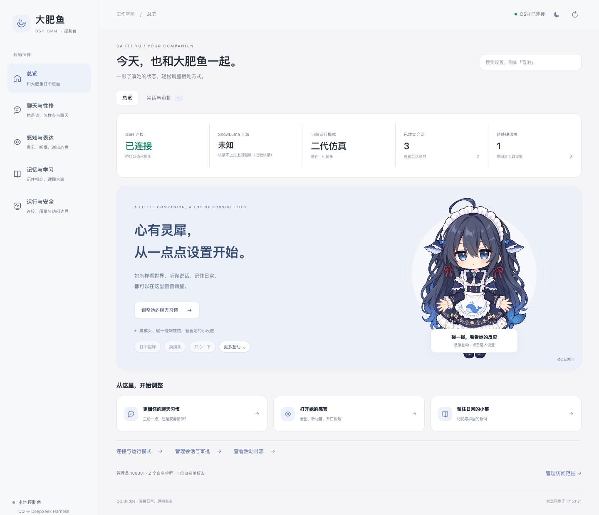
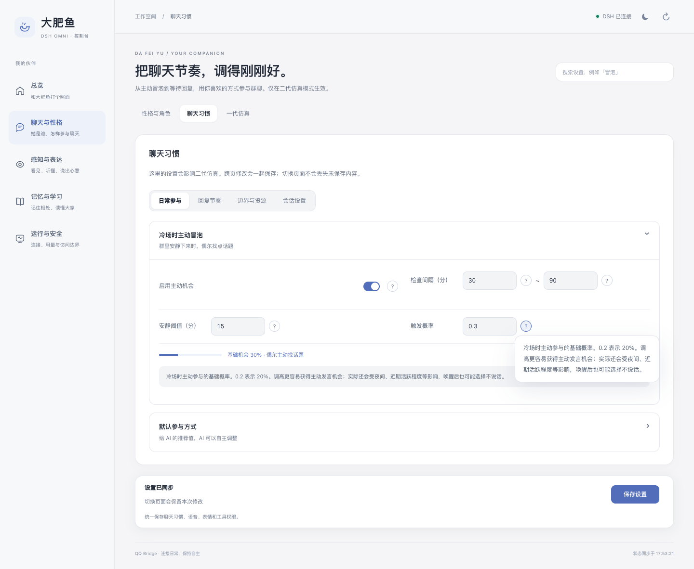

<p align="center">
  
</p>

<h1 align="center">dsh-omni</h1>

<p align="center">把 DeepSeek Harness 接到 QQ，聊天、听语音、看图，也记得住事。</p>

<p align="center">
  <a href="packages/bridge/package.json"></a>
  <a href="#quick-start"></a>
  <a href="LICENSE"></a>
</p>

<p align="center">
  <a href="README.md"></a>
  <a href="README.en.md"></a>
</p>

<p align="center">
  <a href="#preview">看看界面</a> ·
  <a href="#quick-start">快速开始</a> ·
  <a href="#features">功能</a> ·
  <a href="#docs">文档</a> ·
  <a href="https://github.com/dogeheng/dsh-omni/issues">反馈问题</a>
</p>

这是我的 QQ 伙伴「大肥鱼」用的整合包。我想让她能听懂群友的语音、看大家分享的图，记住聊过的事，也知道什么时候该安静。

消息通过 SnowLuma 进出 QQ，由 DeepSeek Harness（DSH）处理对话。角色、权限、聊天节奏和用量都可以在本地控制台里调整。项目基于 [qq-bridge](https://github.com/Derpyu520/qq-bridge) 做整合与二次开发。

<a id="preview"></a>
## 看看界面

<picture>
  <source media="(prefers-color-scheme: dark)" srcset="docs/media/console-overview-dark.png">
  
</picture>

控制台按「总览、聊天与性格、感知与表达、记忆与学习、运行与安全」组织。参数旁有用途和影响说明，也能直接搜索定位。

<details>
<summary>查看聊天设置与参数说明</summary>



比如，调高冒泡概率会增加冷场后的主动参与机会；实际是否开口，还会受到夜间时段、近期活跃程度和 AI 判断的影响。

</details>

### 碰一碰大肥鱼

<p align="center">
  <picture>
    <source media="(prefers-reduced-motion: reduce)" srcset="docs/media/companion-still.png">
    
  </picture>
</p>

碰眼睛会捂眼，碰耳朵会动一动；点一下就能进入对应设置。共九种动作，支持键盘和触屏，也可以暂停。角色采用分层 2D 动画，详见[交互说明](docs/CONSOLE_UI.md)。

<sub>截图与动图均来自离线演示，使用模拟数据，不含真实聊天记录。</sub>

<a id="features"></a>
## 能做什么

| 用途 | 已有功能 |
| --- | --- |
| 参与聊天 | 群聊和私聊分别对应 DSH 会话；支持引用、分条发送、拍一拍、潜水、唤醒与冷场冒泡。 |
| 听与说 | 本地 SenseVoice 语音识别；可选语音合成、语音库和短句随机转语音。支持多种 TTS 服务。 |
| 看图与读链接 | 图片理解、QQ 收藏表情、B 站卡片信息与字幕、联网搜索。B 站工具只读，处理群友分享的内容。 |
| 角色与记忆 | 人格卡和提示词热更新、长期记忆、群内黑话学习。群和私聊的记忆按作用域隔离。 |
| 本地管理 | 白名单、管理员权限、能力与工具开关、token 花费看板；macOS 上还可设置离电省电策略。 |

唱歌、短翻唱、受限文件工作区等能力需要另外准备环境。可以先跑通文字聊天，再按需开启；配置方法见[文档](#docs)。

<details>
<summary>四种运行模式怎么选？</summary>

| 模式 | 行为 |
| --- | --- |
| `chat` | 白名单内的普通对话。 |
| `reserved` | 一代仿真，按触发概率和活跃周期参与群聊。 |
| `reserved2` | 二代仿真，自主阅读、发言、等待、潜水和安排唤醒。 |
| `closed-agent` | 仅管理员私聊可用的 Agent 模式。 |

在「运行与安全 → 连接与模式」切换。想调整二代的参与节奏，到「聊天与性格 → 聊天习惯」。

</details>

<a id="quick-start"></a>
## 快速开始

下面以 **macOS + DSH 桌面版** 为例。先准备 Node.js ≥ 22.13、已安装并登录的 DSH 0.2.x，以及正在运行的 Docker。其他 profile、可选组件和排障见[安装与维护](docs/SETUP.md)。

### 1. 下载并配置

```bash
git clone https://github.com/dogeheng/dsh-omni.git
cd dsh-omni
npm --prefix packages/bridge install
cp -n packages/bridge/config.example.json packages/bridge/config.json
cp -n packages/bridge/.env.example packages/bridge/.env
```

后面的命令都在 **`dsh-omni` 仓库根目录** 执行。

编辑 `packages/bridge/config.json`，填写管理员 `ownerQQ` 和 QQ 白名单 `allow.private` / `allow.groups`。在 `packages/bridge/.env` 里把 `VNC_PASSWD` 改成自己的密码。配置字段说明见[这里](docs/SETUP.md#config)。

### 2. 启动 QQ 网关

```bash
docker compose --env-file packages/bridge/.env -f packages/bridge/docker-compose.snowluma.yml up -d
```

打开 [扫码桌面](http://127.0.0.1:6081) 登录 QQ，再到 [SnowLuma WebUI](http://127.0.0.1:5099) 配置 OneBot v11 HTTP（`3000`）和正向 WebSocket（`3001`）。如启用了访问令牌，把同一个值填入 `snowluma.accessToken`。

### 3. 接入 DSH，再启动桥接

```bash
node packages/bridge/scripts/setup-dsh.mjs desktop
```

安装完成后，**重启 DSH，等它启动好**，再运行：

```bash
bash packages/bridge/start-mac.sh
```

脚本会探测 DSH 当前端口并启动桥接。打开 [本地控制台](http://127.0.0.1:3100)，按提示使用 `packages/bridge/data/console-token` 中的令牌，然后在白名单会话里测试聊天。

DSH 桌面版重启后可能更换端口，需要重新运行启动脚本。也可以安装[自动跟随服务](docs/SETUP.md#watchdog)。

<details>
<summary>只想先试试控制台？</summary>

安装 Node 依赖后运行：

```bash
npm --prefix packages/bridge run preview:console
```

访问 <http://127.0.0.1:4173>。这是离线预览：保存只改内存中的示例数据，试发不会连接 QQ，也不需要登录 DSH。

</details>

<a id="docs"></a>
## 文档

| 想了解什么 | 入口 |
| --- | --- |
| 配置、其他 profile、自动启动、迁移、常见问题 | [安装与维护](docs/SETUP.md) |
| 控制台分类、参数说明、角色互动 | [控制台界面](docs/CONSOLE_UI.md) |
| 消息如何在 QQ 与 DSH 之间流转 | [架构](docs/ARCHITECTURE.md) |
| 语音识别、音色、合成服务与读音修正 | [语音收发](docs/VOICE_IO.md) |
| 记忆的作用域、检索与提炼 | [长期记忆](docs/MEMORY.md) |
| macOS 离电时保留哪些能力 | [电源与省电](docs/POWER.md) |
| 曲库唱歌 / 群内短翻唱 | [唱歌](docs/SINGING.md) · [短翻唱](docs/SHORT_COVER.md) |
| 限制 Agent 文件读写范围 | [文件工作区](docs/SANDBOX.md) |

### 开发与验证

运行代码位于 `packages/bridge`；`packages/launcher` 和 `packages/bili-mcp` 是可选的 DSH 集成组件。

```bash
npm test
npm --prefix packages/bridge run test:console-ui
npm --prefix packages/bridge run test:console-character
```

浏览器检查需要 Playwright 和 Chromium。完整审计有平台与安装环境依赖，已有失败及覆盖范围记录在[验证说明](docs/CONSOLE_UI.md#验证)。修改预设后的构建步骤见[维护文档](docs/SETUP.md#presets)。

## 数据与访问

`config.json`、`.env`、`data/`、`audio/` 留在本机，已加入 `.gitignore`。其中可能包含令牌和聊天记录，请勿上传。控制台及网关默认绑定本机回环地址，聊天范围由白名单控制。

账户余额查询仅用于主人私聊，不会带进群聊提示词。语音合成或其他外接服务可能产生费用，是否启用及用量上限由你配置。

## 来源与许可证

由 [dogeheng](https://github.com/dogeheng) 维护，采用 [MIT](LICENSE)。这个项目用到了以下开源项目：

- [qq-bridge](https://github.com/Derpyu520/qq-bridge)：Derpyu520 与 qq-bridge / QSH contributors，MIT。
- [dsh-bili-scroll](https://github.com/c1overzz/dsh-bili-scroll)：c1overzz，MIT；其内置的 bilibili-mcp 来自 AGI_Ananas，MIT。
- [Seed-VC](https://github.com/Plachtaa/seed-vc)：Plachtaa，GPL-3.0。可选组件，通过独立进程调用，代码和权重未打包进本仓库。

完整第三方声明见 [NOTICE.md](NOTICE.md)。
